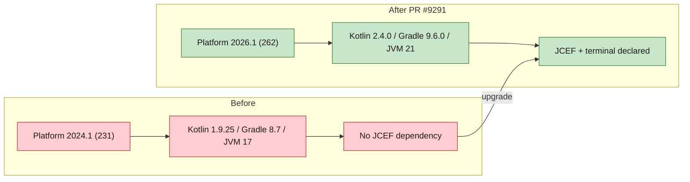

# [Bug][ide plugin]: PyCharm 2025.3.3 cannot install the JiuwenSwarm plugin — "requires IDE build 262 or newer" — jiuwenswarm

## Executive Summary

The JiuwenSwarm JetBrains plugin could not be installed on PyCharm 2025.3.3
(`PY-253.31033.139`): the packaged plugin declared `sinceBuild = 262`, so the IDE
rejected it with *"Plugin 'JiuwenSwarm — AI Code Agent' (com.jiuwenswarm.ide-plugin,
version=0.1.0) requires IDE build 262 or newer"*.

The fix ports the JetBrains **2026.1 / build 262** platform upgrade into the plugin
that ships from this repository (`jiuwenswarm/channels/ide/packages/jetbrains-plugin`),
so current builds consistently target the newest platform line, declare the JCEF
dependency required by 2026.1, and build with the current Gradle/Kotlin toolchain.
The plugin is compiled against the reproducible `intellijIdea("2026.1")` platform
coordinate, but its install floor is `sinceBuild = 253`, so it installs on PyCharm
2025.3.3 (build 253) and newer, including 2026.1 (build 262).

Issue #8460 https://github.com/openJiuwen-ai/jiuwenswarm/issues/8460<br>
PR #9291 https://github.com/openJiuwen-ai/jiuwenswarm/pull/9291<br>
Original implementation commit in `jiuwenswarm-ide`: `a4a1144` (2026-10-14)

## 🐞 Detailed Description of the Problem

Installing the JiuwenSwarm plugin on PyCharm 2025.3.3 fails. The IDE log reports:

```
Plugin 'JiuwenSwarm — AI Code Agent' (com.jiuwenswarm.ide-plugin,version=0.1.0)
requires IDE build 262 or newer, but the current build is PY-253.31033.139
```

### Root cause

Two different plugin build definitions existed:

| Location | Target | `sinceBuild` | Result |
|---|---|---|---|
| `jiuwenswarm-ide` (released build, Oct 14) | JetBrains 2026.1 / build 262 | `262` | Installs only on 2026.1+; rejected by `PY-253` |
| `jiuwenswarm` → `channels/ide` (this repo) | IntelliJ Platform 2024.1 | `231` | Stale: old toolchain, no JCEF declaration, out of sync with the current platform |

The plugin package installed by the reporter was produced from the 262 build, while
the in-repo build definition in `jiuwenswarm` was still pinned to 2024.1
(Kotlin `1.9.25`, IntelliJ Platform Gradle plugin `2.1.0`, Gradle `8.7`, JVM 17).
The mismatch caused two separate problems:

1. The published plugin carried `sinceBuild = 262`, so build 253 was rejected.
2. The in-repo build no longer matched the platform generation of the published
   artifact and was missing the bundled `com.intellij.modules.jcef` dependency that
   newer platforms provide separately.

### Environment

| Item | Value |
|---|---|
| IDE | PyCharm 2025.3.3 |
| IDE build | `PY-253.31033.139` |
| Plugin | `com.jiuwenswarm.ide-plugin` v0.1.0 |
| OS | Windows |
| Module | `jiuwenswarm/channels/ide/packages/jetbrains-plugin` |

## Solution

Paired: [GitHub #8460](https://github.com/openJiuwen-ai/jiuwenswarm/issues/8460) ↔
[GitHub PR #9291](https://github.com/openJiuwen-ai/jiuwenswarm/pull/9291)

PR #9291 applies the 2026.1 platform upgrade to the plugin shipped by `jiuwenswarm`:

| Setting | Before | After |
|---|---|---|
| Kotlin | `1.9.25` | `2.4.0` |
| IntelliJ Platform Gradle plugin | `2.1.0` | `2.19.0` |
| Platform SDK | `intellijIdeaCommunity("2024.1")` | `intellijIdea("2026.1")` (optional local override) |
| Gradle wrapper | `8.7` | `9.6.0` |
| JVM toolchain | `17` | `21` |
| `sinceBuild` | `231` | `253` |
| Bundled plugins | terminal only | terminal + `com.intellij.modules.jcef` |

Files changed:

```
jiuwenswarm/channels/ide/packages/jetbrains-plugin/build.gradle.kts
jiuwenswarm/channels/ide/packages/jetbrains-plugin/gradle/wrapper/gradle-wrapper.properties
jiuwenswarm/channels/ide/packages/jetbrains-plugin/src/main/resources/META-INF/plugin.xml
```

`plugin.xml` now declares the JCEF dependency used by the chat/map panels:

```xml
<depends>com.intellij.modules.platform</depends>
<depends>org.jetbrains.plugins.terminal</depends>
<!-- JCEF is a separate bundled plugin on newer platforms; the chat/map panels are JBCefBrowser. -->
<depends>com.intellij.modules.jcef</depends>
```



### Compatibility note

The plugin declares `sinceBuild = 253` with an open upper bound. It installs on
PyCharm 2025.3.3 (build 253) and newer, including JetBrains 2026.1 (build 262),
while being compiled against the 2026.1 platform. This addresses the original
installation failure instead of narrowing the supported range.

### Reproducible platform build

The default SDK is the versioned, downloadable coordinate:

```kotlin
intellijIdea("2026.1")
```

Developers can opt into a locally installed IDE without committing a
machine-specific path:

```bash
./gradlew buildPlugin -PjetbrainsIdePath="/opt/idea"
# or
export JETBRAINS_IDE_PATH="/opt/idea"
./gradlew buildPlugin
```

The publishing guide (`channels/ide/publishing/jetbrains/PUBLISHING.md`) uses the
same reproducible defaults, JDK 21, Gradle 9.6, and the `253` install floor. The
previous hardcoded `C:\Program Files\JetBrains\WebStorm 2026.1` path is removed.

## Verification

- `./gradlew buildPlugin` with JDK 21 using the default `intellijIdea("2026.1")`
  coordinate: **BUILD SUCCESSFUL**.
- Artifact produced: `build/distributions/jiuwenswarm-plugin-0.1.0.zip`.
- Generated manifest carries `sinceBuild = 253`, an open `untilBuild`, and the JCEF
  dependency, so the plugin installs on 2025.3+ while targeting the 2026.1 platform.
- The same build succeeds on a machine without WebStorm installed at the old
  hardcoded path; a local SDK can still be selected via `-PjetbrainsIdePath` or
  `JETBRAINS_IDE_PATH`.
- The Kotlin sources compile and the plugin zip is packaged successfully with the
  updated toolchain.

## Version Information

| Version |
|---|
| 0.1.0 |

## PR summary

**What type of PR is this?**
`/kind bug`

**What does this PR do / why do we need it**
Aligns the JiuwenSwarm JetBrains plugin with the newest JetBrains platform line
(2026.1, build 262): upgrades Kotlin, the IntelliJ Platform Gradle plugin, Gradle and
the JVM toolchain, declares the JCEF dependency, and sets `sinceBuild = 253` so the
plugin remains installable on PyCharm 2025.3.3 and newer. Uses the reproducible
`intellijIdea("2026.1")` coordinate by default with an optional local-SDK override,
removing the committed machine-specific path.

**Which issue(s) this PR fixes**
Fixes #8460

**Verification**
`./gradlew buildPlugin` succeeds and produces `jiuwenswarm-plugin-0.1.0.zip` with
`sinceBuild = 262` and the JCEF dependency declared.

**Branch / commits**

| Item | Value |
|---|---|
| Branch | `fix/ide-jetbrains-platform-2026-1` |
| Commit | `c6ee040d5` `fix(ide): support JetBrains platform 2026.1 (build 262)`<br>`b6532e78d` `fix(ide): make JetBrains platform build reproducible` |
| Merged into | `New-Features-Integration` (`50d868a54`, `1371bbc58`) |
