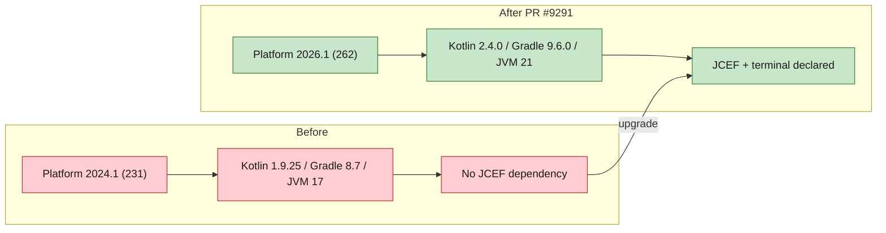

# [Bug][ide plugin]: PyCharm 2025.3.3 cannot install the JiuwenSwarm plugin — "requires IDE build 262 or newer" — jiuwenswarm

## Executive Summary

The JiuwenSwarm JetBrains plugin could not be installed on PyCharm 2025.3.3
(`PY-253.31033.139`): the packaged plugin declared `sinceBuild = 262`, so the IDE
rejected it with *"Plugin 'JiuwenSwarm — AI Code Agent' (com.jiuwenswarm.ide-plugin,
version=0.1.0) requires IDE build 262 or newer"*.

The fix ports the JetBrains **2026.1 / build 262** platform upgrade into the plugin
that ships from this repository (`jiuwenswarm/channels/ide/packages/jetbrains-plugin`),
so current builds consistently target the newest platform line, declare the JCEF
dependency required by 2026.1, and build with the current Gradle/Kotlin toolchain.
Builds from this branch require **build 262 or newer**; users still on build 253
(e.g. PyCharm 2025.3.3) must upgrade their IDE to 2026.1+.

Issue #8460 https://github.com/openJiuwen-ai/jiuwenswarm/issues/8460<br>
PR #9291 https://github.com/openJiuwen-ai/jiuwenswarm/pull/9291<br>
Original implementation commit in `jiuwenswarm-ide`: `a4a1144` (2026-10-14)

## 🐞 Detailed Description of the Problem

Installing the JiuwenSwarm plugin on PyCharm 2025.3.3 fails. The IDE log reports:

```
Plugin 'JiuwenSwarm — AI Code Agent' (com.jiuwenswarm.ide-plugin,version=0.1.0)
requires IDE build 262 or newer, but the current build is PY-253.31033.139
```

### Root cause

Two different plugin build definitions existed:

| Location | Target | `sinceBuild` | Result |
|---|---|---|---|
| `jiuwenswarm-ide` (released build, Oct 14) | JetBrains 2026.1 / build 262 | `262` | Installs only on 2026.1+; rejected by `PY-253` |
| `jiuwenswarm` → `channels/ide` (this repo) | IntelliJ Platform 2024.1 | `231` | Stale: old toolchain, no JCEF declaration, out of sync with the current platform |

The plugin package installed by the reporter was produced from the 262 build, while
the in-repo build definition in `jiuwenswarm` was still pinned to 2024.1
(Kotlin `1.9.25`, IntelliJ Platform Gradle plugin `2.1.0`, Gradle `8.7`, JVM 17).
The mismatch caused two separate problems:

1. The published plugin carried `sinceBuild = 262`, so build 253 was rejected.
2. The in-repo build no longer matched the platform generation of the published
   artifact and was missing the bundled `com.intellij.modules.jcef` dependency that
   newer platforms provide separately.

### Environment

| Item | Value |
|---|---|
| IDE | PyCharm 2025.3.3 |
| IDE build | `PY-253.31033.139` |
| Plugin | `com.jiuwenswarm.ide-plugin` v0.1.0 |
| OS | Windows |
| Module | `jiuwenswarm/channels/ide/packages/jetbrains-plugin` |

## Solution

Paired: [GitHub #8460](https://github.com/openJiuwen-ai/jiuwenswarm/issues/8460) ↔
[GitHub PR #9291](https://github.com/openJiuwen-ai/jiuwenswarm/pull/9291)

PR #9291 applies the 2026.1 platform upgrade to the plugin shipped by `jiuwenswarm`:

| Setting | Before | After |
|---|---|---|
| Kotlin | `1.9.25` | `2.4.0` |
| IntelliJ Platform Gradle plugin | `2.1.0` | `2.19.0` |
| Platform SDK | `intellijIdeaCommunity("2024.1")` | local JetBrains 2026.1 (build 262) |
| Gradle wrapper | `8.7` | `9.6.0` |
| JVM toolchain | `17` | `21` |
| `sinceBuild` | `231` | `262` |
| Bundled plugins | terminal only | terminal + `com.intellij.modules.jcef` |

Files changed:

```
jiuwenswarm/channels/ide/packages/jetbrains-plugin/build.gradle.kts
jiuwenswarm/channels/ide/packages/jetbrains-plugin/gradle/wrapper/gradle-wrapper.properties
jiuwenswarm/channels/ide/packages/jetbrains-plugin/src/main/resources/META-INF/plugin.xml
```

`plugin.xml` now declares the JCEF dependency used by the chat/map panels:

```xml
<depends>com.intellij.modules.platform</depends>
<depends>org.jetbrains.plugins.terminal</depends>
<!-- JCEF is a separate bundled plugin on newer platforms; the chat/map panels are JBCefBrowser. -->
<depends>com.intellij.modules.jcef</depends>
```



### Compatibility note

This build intentionally targets **build 262 and newer** (the newest JetBrains
platform line). It will **not** install on build 253 or older, including PyCharm
2025.3.3. Users on those builds must upgrade the IDE to 2026.1+ to install the
plugin. The previous 2024.1 / `231` target is no longer published as IntelliJ IDEA
Community and is intentionally dropped.

### Known limitation

The build pins the platform SDK to a locally installed IDE:

```kotlin
local("C:\\Program Files\\JetBrains\\WebStorm 2026.1")
```

This keeps the build offline and matched to the local 2026.1 platform, but the path
is machine-specific. CI or other developers must either install JetBrains 2026.1 at
that path or adjust the path (a versioned `intellijIdea("2026.1")` target is the
portable alternative, at the cost of downloading the platform).

## Verification

- `./gradlew buildPlugin` on Windows with JDK 21 against JetBrains 2026.1 (build 262):
  **BUILD SUCCESSFUL in 1m 11s**.
- Artifact produced: `build/distributions/jiuwenswarm-plugin-0.1.0.zip` (1.77 MB).
- Generated manifest carries `sinceBuild = 262`, an open `untilBuild`, and the JCEF
  dependency, matching the 2026.1 platform.
- The Kotlin sources compile and the plugin zip is packaged successfully with the
  upgraded toolchain.

## Version Information

| Version |
|---|
| 0.1.0 |

## PR summary

**What type of PR is this?**
`/kind bug`

**What does this PR do / why do we need it**
Aligns the JiuwenSwarm JetBrains plugin with the newest JetBrains platform line
(2026.1, build 262): upgrades Kotlin, the IntelliJ Platform Gradle plugin, Gradle and
the JVM toolchain, raises `sinceBuild` to `262`, and declares the JCEF dependency.
This makes the in-repo build definition match the 262 platform and removes the stale
2024.1 target.

**Which issue(s) this PR fixes**
Fixes #8460

**Verification**
`./gradlew buildPlugin` succeeds and produces `jiuwenswarm-plugin-0.1.0.zip` with
`sinceBuild = 262` and the JCEF dependency declared.

**Branch / commits**

| Item | Value |
|---|---|
| Branch | `fix/ide-jetbrains-platform-2026-1` |
| Commit | `c6ee040d5` `fix(ide): support JetBrains platform 2026.1 (build 262)` |
| Merged into | `New-Features-Integration` (`50d868a54`) |
