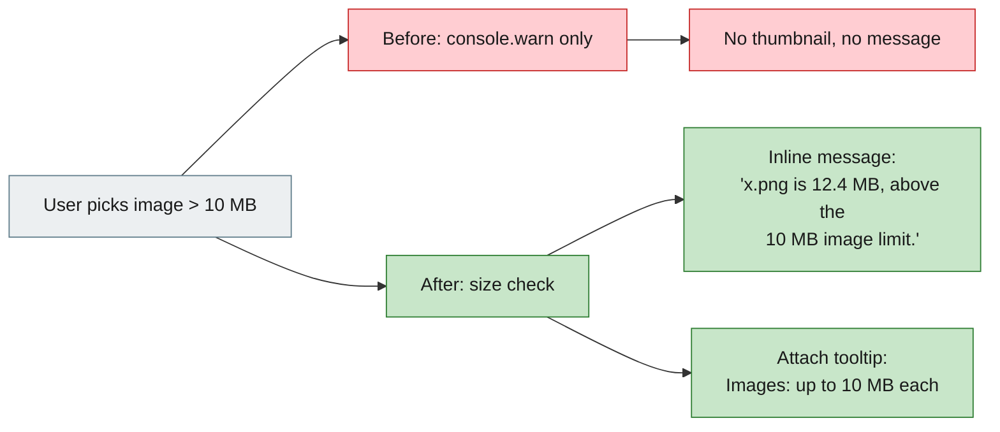

# [Bug][ide plugin]: Uploading an image over 10 MB gives no feedback in the IDE plugins — jiuwenswarm

## Executive Summary

In both the PyCharm and VS Code plugins, selecting an image larger than 10 MB did
nothing: no preview thumbnail, no message, no error. The shared chat webview already
enforced a 10 MB per-image limit, but rejected files with a `console.warn` only, and
the attach button title did not mention the limit.

The fix adds the missing user feedback: the attach button tooltip now says
`Images: up to 10 MB each`, and rejected files show a transient in-UI message with
the file size / type reason. The 10 MB limit itself is unchanged and matches the
WebUI.

Issue #8929 https://github.com/openJiuwen-ai/jiuwenswarm/issues/8929<br>
PR #9293 https://github.com/openJiuwen-ai/jiuwenswarm/pull/9293<br>
Paired: [GitCode #5534](https://gitcode.com/openJiuwen/jiuwenswarm/issues/5534)

## 🐞 Detailed Description of the Problem

Reproduction:

1. Install the JiuwenSwarm plugin in PyCharm or VS Code.
2. Click the `+` attach button and choose an image larger than 10 MB.
3. Nothing happens: no thumbnail is added and no message is shown.

Expected: the plugin rejects the oversized image and tells the user why.

### Root cause

Both IDE plugins render the same webview source,
`jiuwenswarm/channels/ide/packages/shared-webview/chat.html`. Its
`handleImageInput()` enforced the 10 MB limit but only wrote to the developer
console:

```js
if (!validTypes.includes(file.type)) {
  console.warn('[webview] Unsupported image type:', file.type);
  return;
}
if (file.size > maxSize) {
  console.warn('[webview] Image too large:', file.name, file.size);
  return;
}
```

The attach button also had `title="Add Image"`, with no hint about the limit. From
the user's perspective the file was silently ignored.

The WebUI (`channels/web/frontend/src/components/ChatPanel/InputArea.tsx`) handles
the same limit with `MAX_IMAGE_BYTES = 10 * 1024 * 1024`, an attach tooltip
(`Images: up to {{limit}}M each`) and an in-UI alert
(`File size exceeds limit: {{name}} (image max {{limit}})`).

### Environment

| Item | Value |
|---|---|
| IDE | PyCharm and VS Code |
| Plugin | JiuwenSwarm IDE plugin |
| OS | Windows |
| Module | `jiuwenswarm/channels/ide/packages/shared-webview/chat.html` |
| Limit | 10 MB per image (`10 * 1024 * 1024` bytes) |

## Solution

Changes in `jiuwenswarm/channels/ide/packages/shared-webview/chat.html` (shared by
both IDE plugins):

- Attach button tooltip: `Images: up to 10 MB each`.
- New `#attachment-error` status area with `role="status"` and `aria-live="polite"`,
  styled with the existing error theme variables.
- `showAttachmentError(message)` displays a transient (5 s) message.
- Rejection messages:
  - oversized: `"<name>" is <size>, above the 10 MB image limit.`
  - unsupported type: `Unsupported image type: <type>. Use PNG, JPEG, WebP or GIF.`
  - read failure: `Failed to read image: <name>`

```js
if (file.size > maxSize) {
  showAttachmentError('"' + file.name + '" is ' + fmtBytes(file.size) + ', above the 10 MB image limit.');
  return;
}
```



### Compatibility

No external interface change. The 10 MB per-image limit and the accepted formats
(PNG, JPEG, WebP, GIF) are unchanged; only the user-visible feedback is added.
Valid images still attach and preview normally.

## Verification

- `npm run build` (VS Code extension, copies `shared-webview/chat.html`) completes
  successfully.
- Generated `resources/chat.html` contains the new tooltip, `#attachment-error`
  element and the size/type messages.
- Behaviour: an oversized image now produces the inline limit message instead of
  silently doing nothing; unsupported types and read failures also report.
- The JetBrains plugin copies the same shared webview during `processResources`, so
  PyCharm and VS Code both receive the fix.

## Version Information

| Version |
|---|
| 0.1.0 |

## PR summary

**What type of PR is this?**
`/kind bug`

**What does this PR do / why do we need it**
Adds user-visible feedback for rejected image attachments in the shared IDE chat
webview: attach tooltip with the 10 MB limit, and inline messages for oversized,
unsupported or unreadable images.

**Which issue(s) this PR fixes**
Fixes #8929

**Verification**
`npm run build` passes; the generated webview contains the new tooltip and error
messages. The 10 MB limit and accepted formats are unchanged.

**Branch / commits**

| Item | Value |
|---|---|
| Branch | `fix/ide-image-upload-limit-feedback` |
| Commit | `01d0f54a3` `fix(ide): show image upload limit feedback in chat webview` |
| Merged into | `New-Features-Integration` (`382dc74e0`) |
