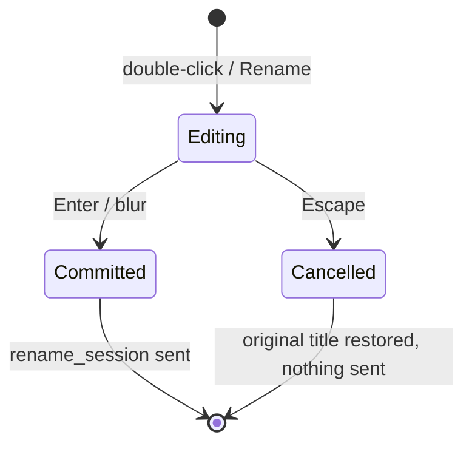

# [Bug][ide plugin]: Pressing Escape while renaming a session still saves the new title — jiuwenswarm

## Executive Summary

In the PyCharm and VS Code plugins, renaming the current session from the chat
header (double-click the title, or the menu's **Rename** item) and pressing
`Escape` did not cancel the edit: the new title was saved anyway.

Root cause: the shared chat webview removed the focused rename input on `Escape`.
Removing a focused element fires `blur`, and the `blur` handler called `save()`,
committing the typed title. The fix replaces `save()` with a guarded
`finish(commit)` so `Escape` restores the original title and no rename is sent.

Issue #8910 https://github.com/openJiuwen-ai/jiuwenswarm/issues/8910<br>
PR #9294 https://github.com/openJiuwen-ai/jiuwenswarm/pull/9294<br>
Paired: [GitCode #5525](https://gitcode.com/openJiuwen/jiuwenswarm/issues/5525)

## 🐞 Detailed Description of the Problem

Reproduction:

1. Double-click the session title in the chat header (or open the menu and choose
   **Rename**).
2. Type a new name.
3. Press `Escape`.

Expected: the rename is cancelled and the original title remains.
Actual: the new title is saved.

The same behaviour is present in both IDE plugins because they render the same
webview source.

### Root cause

`jiuwenswarm/channels/ide/packages/shared-webview/chat.html` →
`startRenameSession()`:

```js
function save() {
  var val = inp.value.trim();
  if (val && val !== current) {
    state.sessionTitle = val;
    send({ type: 'rename_session', title: val });
  }
  htEl.textContent = val || current;
  htEl.style.display = '';
  inp.remove();
}
inp.addEventListener('blur', save);
inp.addEventListener('keydown', function(e) {
  if (e.key === 'Enter') { e.preventDefault(); save(); }
  if (e.key === 'Escape') { htEl.style.display = ''; inp.remove(); }
});
```

On `Escape` the focused `<input>` is removed, which fires `blur`; the `blur`
handler invokes `save()` and sends `rename_session` with the typed value.

### Environment

| Item | Value |
|---|---|
| IDE | PyCharm and VS Code |
| Plugin | JiuwenSwarm IDE plugin |
| OS | Windows |
| Module | `jiuwenswarm/channels/ide/packages/shared-webview/chat.html` |
| Entry points | Double-click header title, menu **Rename** |

## Solution

Replaced `save()` with a single guarded `finish(commit)`:

```js
var finished = false;
function finish(commit) {
  if (finished) return;
  finished = true;
  var val = inp.value.trim();
  if (commit && val && val !== current) {
    state.sessionTitle = val;
    send({ type: 'rename_session', title: val });
  }
  // Escape restores the original title; Enter/click commits the edited value.
  htEl.textContent = commit ? (val || current) : current;
  htEl.style.display = '';
  inp.remove();
}
inp.addEventListener('blur', function() { finish(true); });
inp.addEventListener('keydown', function(e) {
  if (e.key === 'Enter') { e.preventDefault(); finish(true); }
  if (e.key === 'Escape') { e.preventDefault(); finish(false); }
});
```

- `Escape` → `finish(false)`: restore the original title, send nothing.
- `Enter` or clicking elsewhere → `finish(true)`: commit as before.
- The `finished` flag makes the `blur` triggered by `inp.remove()` a no-op, so a
  cancelled edit cannot be saved by the induced blur.



### Compatibility

No external interface change. `Enter` and click-away still save the title; only the
cancel path is corrected. Both IDE plugins share the same webview, so the fix
applies to PyCharm and VS Code.

## Verification

- `npm run build` (VS Code extension, copies `shared-webview/chat.html`) completes
  successfully.
- Generated `resources/chat.html` contains the new `finish(commit)` logic and
  `finish(false)` on `Escape`.
- Expected runtime behaviour: `Escape` reverts the title and sends no
  `rename_session`; `Enter`/blur still persists the new title. The blur triggered
  by removing the input is ignored after cancellation.
- The JetBrains plugin copies the same webview during `processResources`, so both
  IDEs receive the fix.

## Version Information

| Version |
|---|
| 0.1.0 |

## PR summary

**What type of PR is this?**
`/kind bug`

**What does this PR do / why do we need it**
Makes `Escape` cancel a session rename instead of committing it, by guarding the
commit behind a `finished` flag shared by the keyboard and blur handlers.

**Which issue(s) this PR fixes**
Fixes #8910

**Verification**
`npm run build` passes; the generated webview contains `finish(false)` for Escape
and `finish(true)` for Enter/blur. No `rename_session` is sent after cancellation.

**Branch / commits**

| Item | Value |
|---|---|
| Branch | `fix/ide-session-rename-escape` |
| Commit | `58350edbe` `fix(ide): cancel session rename on Escape` |
| Merged into | `New-Features-Integration` (`c85ddfdb8`) |
