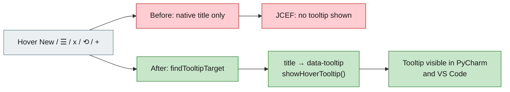

# [Bug][ide plugin]: Icon hover hints missing in PyCharm plugin (JCEF) — jiuwenswarm

## Executive Summary

In the PyCharm plugin, hovering icon controls showed no hint: the **New** button,
the **☰** menu, the session delete **x**, the **⟲** refresh buttons, the **+** attach
button, and other titled controls. The same webview in VS Code showed the hints.

Root cause: the shared chat webview has its own custom tooltip because native
`title=` tooltips are unreliable in JetBrains' JCEF, but the custom handler only
matched three selectors (`.stat-badge`, `.stat-chip`, `.traj-toggle`). Every other
control relied on native `title=`, which JCEF does not render.

The fix routes every element with `data-tooltip` or `title` through the custom
tooltip, converting `title` to `data-tooltip` on first hover and re-syncing when the
app updates `title` dynamically.

Issue #8894 https://github.com/openJiuwen-ai/jiuwenswarm/issues/8894<br>
PR #9295 https://github.com/openJiuwen-ai/jiuwenswarm/pull/9295<br>
Paired: [GitCode #5518](https://gitcode.com/openJiuwen/jiuwenswarm/issues/5518)

## 🐞 Detailed Description of the Problem

| Control | Attribute in the webview | Hint in VS Code | Hint in PyCharm |
|---|---|---|---|
| **New** | `title="New session"` | yes | no |
| **☰** menu | `title="Menu"` | yes | no |
| session **x** | `delBtn.title = 'Delete session'` | yes | no |
| **⟲** refresh | `title="Refresh"` | yes | no |
| **+** attach | `title="Images: up to 10 MB each"` | yes | no |
| send / mode / model / git, menu items | `title=...` | yes | no |

### Root cause

`jiuwenswarm/channels/ide/packages/shared-webview/chat.html` already says:

```html
/* Custom hover tooltip (native title= is unreliable in JCEF) */
```

but the event handlers only matched a few selectors:

```js
e.target.closest('.stat-badge[data-tooltip], .stat-chip[data-tooltip], .traj-toggle[data-tooltip]')
```

Anything else used native `title=`, which JCEF does not display. Electron (VS Code)
does display native title tooltips, which is why the two plugins behaved
differently.

### Environment

| Item | Value |
|---|---|
| IDE | PyCharm (JCEF webview); VS Code (Electron) |
| Plugin | JiuwenSwarm IDE plugin |
| OS | Windows |
| Module | `jiuwenswarm/channels/ide/packages/shared-webview/chat.html` |

## Solution

Replace the selector-specific lookup with a generic `findTooltipTarget()`:

```js
function findTooltipTarget(node) {
  if (!node || !node.closest) return null;
  var t = node.closest('[data-tooltip], [title]');
  if (!t) return null;
  // The copy button already renders its tooltip via CSS.
  if (t.classList && t.classList.contains('copy-btn')) return null;
  var title = t.getAttribute('title');
  if (title !== null) {
    if (t.getAttribute('data-tooltip') !== title) {
      t.setAttribute('data-tooltip', title);
    }
    t.removeAttribute('title');
  }
  return t;
}
document.addEventListener('mouseover', function(e) {
  var t = findTooltipTarget(e.target);
  if (t) showHoverTooltip(t);
});
document.addEventListener('mouseout', function(e) {
  var t = findTooltipTarget(e.target);
  if (t) hideHoverTooltip();
});
```

- Any `title` becomes a styled `data-tooltip`, so JCEF displays it.
- The native `title` is removed so Electron does not show a duplicate.
- Dynamic titles (session delete buttons, status dot, etc.) are picked up when set
  and re-synced if changed.
- The existing CSS-only tooltip on `.copy-btn` is preserved.



### Compatibility

No DOM structure changes to the controls; only hover behavior. Controls that
already had `data-tooltip` keep working. VS Code switches from the native tooltip
to the same styled tooltip, making the two plugins consistent.

## Verification

- `npm run build` (VS Code extension, copies `shared-webview/chat.html`) completes
  successfully.
- Generated `resources/chat.html` contains `findTooltipTarget`.
- Expected runtime behaviour: hovering New, ☰, session delete/refresh, `+` attach,
  send, mode/model, git and menu items shows the styled tooltip in PyCharm (JCEF)
  where native `title=` does not render.
- The JetBrains plugin copies the same shared webview during `processResources`, so
  both IDEs receive the fix.

## Version Information

| Version |
|---|
| 0.1.0 |

## PR summary

**What type of PR is this?**
`/kind bug`

**What does this PR do / why do we need it**
Routes every titled control (New, menu, delete, refresh, attach, etc.) through the
existing custom tooltip so hover hints appear in PyCharm's JCEF webview.

**Which issue(s) this PR fixes**
Fixes #8894

**Verification**
`npm run build` passes and the generated webview contains `findTooltipTarget`.
Titles are converted to `data-tooltip` on hover and re-synced when updated.

**Branch / commits**

| Item | Value |
|---|---|
| Branch | `fix/ide-tooltips-jcef` |
| Commit | `da8187a37` `fix(ide): show tooltips for all titled controls in JCEF` |
| Merged into | `New-Features-Integration` (`126cb8ca8`) |
