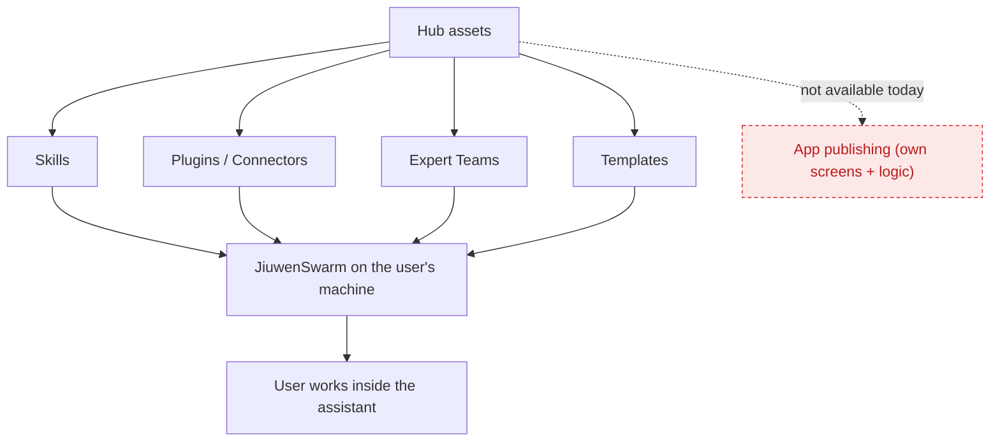
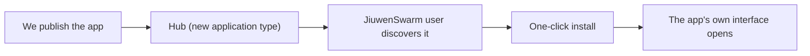
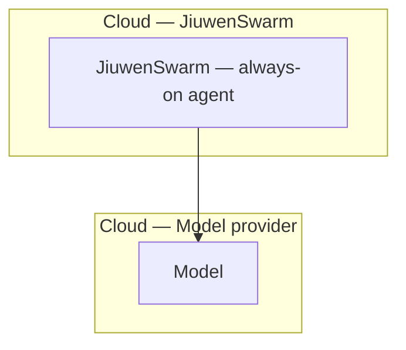
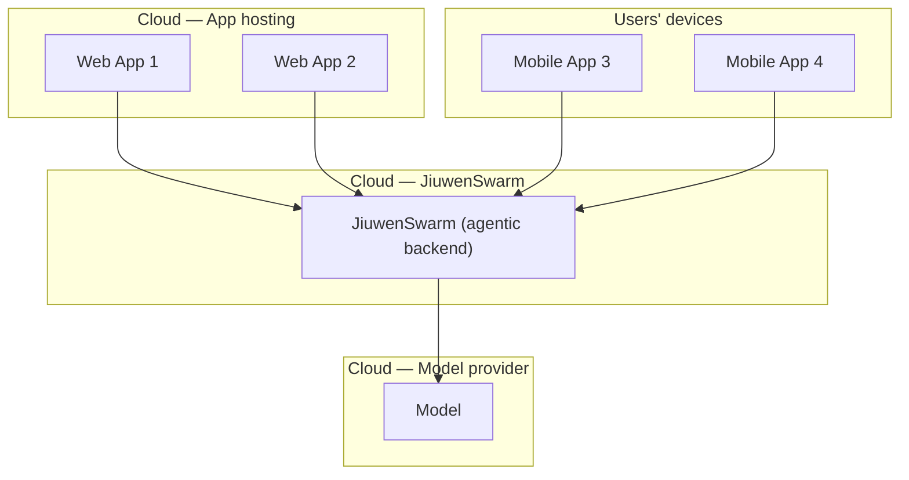
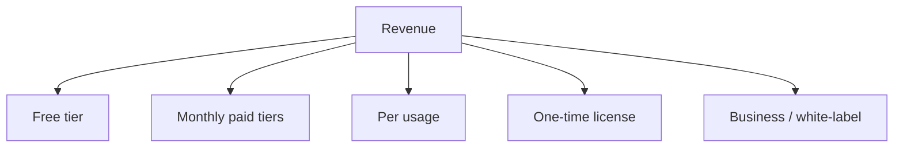
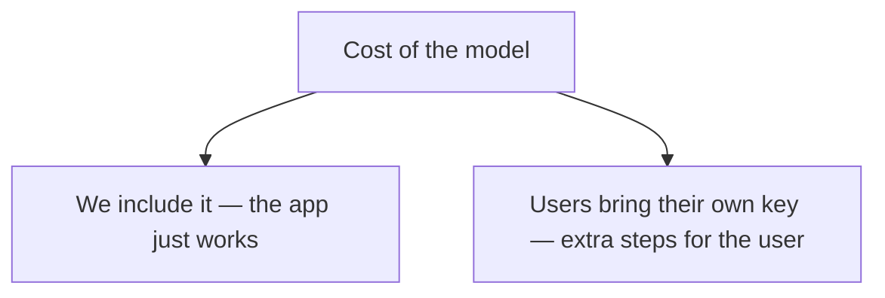

# Publishing Apps Built on JiuwenSwarm

This document explains how applications such as InkWell or TopSpin can be made available to users. It covers three things: the option of publishing as a plugin, what is possible today and what is not, and the practical route of running everything ourselves — followed by how this can be monetized.

The intended readers are managers. Nothing here is technical.

---

## 1. Publishing as a plugin (the suggestion that was raised)

**The idea.** JiuwenSwarm has a public Hub where creators can publish assets. The suggestion was to publish our apps there as plugins, so that JiuwenSwarm users could discover and use them.

**What the Hub can publish today.** The Hub accepts these kinds of assets:

- **Skills** — knowledge and instructions that guide the assistant.
- **Plugins / Connectors** — tools that let the assistant perform actions.
- **Expert Teams** — several agents working together on a task.
- **Templates** — starting points for building an agent.

**What these assets have in common.** All of them assume the same situation: the user is running JiuwenSwarm on their own machine and working inside it. Each asset adds a capability to that assistant — more knowledge, more tools, or more coordination. None of them is a complete application with its own screens and its own behavior as a standalone product.

**Why this is limiting for our apps.** InkWell and TopSpin are complete applications: they have their own interface, their own flow, and their own logic. A plugin can share the knowledge or the tools behind such an app, but it cannot deliver the app itself — the screens and the experience. So publishing as a plugin today would share part of what we built, not the product.

**What would make it possible.** For a full app like InkWell or TopSpin to be published and installed the same way plugins are today, two capabilities need to be added — and both depend on the Jiuwen team, not on us:

1. **A new publishing type on the Hub for complete applications** — a package that carries both the app's interface and its logic, as one unit.
2. **A matching install capability in JiuwenSwarm** — so that a user can install such an app with a single action, and JiuwenSwarm sets it up automatically, including displaying the app's own interface — not only using its skills or tools.

**What it would look like once available.** Publishing a full app would feel like publishing a plugin does today: we submit it, it appears on the Hub, a JiuwenSwarm user finds it and installs it in one step. This is the natural distribution channel *inside* the ecosystem, and it is complementary to the approach described in the next section. It is simply not available yet, and it is not something we can build on our own.

---

## 2. Real deployment — running it ourselves

Since the in-ecosystem route depends on the Jiuwen team, the practical path available to us now is to operate the whole system ourselves. This has three parts.

### 2.1 Hosting JiuwenSwarm

We run JiuwenSwarm on a cloud server with a public address. From that point on:

- JiuwenSwarm becomes an **always-on agent** — a continuously running assistant that users reach over the internet, rather than something they install and start on their own machine. This is the same model as consumer agents such as Meta Muse, OpenAI Dots, or xAI Grok: the intelligence lives in the cloud and is simply there whenever the user needs it.
- Its capabilities are **always available** to anything that connects to it.

This is the foundation. Everything below depends on it.

### 2.2 Our web and mobile apps in the cloud

With JiuwenSwarm hosted and reachable, our apps become the **front end** and JiuwenSwarm becomes the **engine behind them**.

- The app presents a simple, focused interface for the user.
- The app sends the actual work to JiuwenSwarm, which does the reasoning and produces the result.
- In other words, JiuwenSwarm acts as the **agentic backend**, and our apps are mostly the experience on top of it.

All apps are equal in nature — each is a front end to the same backend. The only difference is how each one reaches the user:

- **Web apps at permanent links** — for example `https://…/apps/topspin` and `https://…/apps/inkwell`. The app is already set up for the user; they simply open the link and use it. There is nothing to clone, install, or set up.
- **Mobile apps in the app stores** — the same apps, packaged for phones. The user first installs the app from the store, then opens it. From that point on it behaves exactly like the web version, because it uses the same hosted backend.

The result is a product that users can actually reach: through a link or through a store listing.

### 2.3 Why this shape works

- It puts the product directly in front of users, with no setup on their side.
- One backend serves every front end — web and mobile stay consistent because they rely on the same engine.
- It gives us control over the experience, the usage limits, and the pricing, without waiting for changes elsewhere.

---

## 3. Monetization

Once the system is hosted and users can reach the apps, revenue can be structured similarly to how other always-on agents are packaged. Pricing can take a few forms:

- **Free tier.** A limited amount of usage per month — enough to experience the product, not enough to run a business on.
- **Monthly paid tiers.** Higher limits, faster processing, and additional features — the subscription model, where most of the revenue comes from.
- **Per usage.** Charging for what the user actually receives, such as minutes analyzed or results produced, rather than a flat monthly fee. This suits apps that do heavy processing, such as video analysis.
- **One-time license.** A single payment for a defined version of the app.
- **Business / white-label.** Higher-value offerings for clubs, coaches, and schools.

**Covering the cost of the model.** There are two ways to handle the cost of the intelligence behind the apps:

- **We include it.** The app simply works; we cover the model usage and recover the cost through the paid tiers. This is the simplest for users.
- **Users bring their own provider key.** The user supplies their own model access; we charge for the app and the processing rather than for the intelligence. The user manages their own model access, which adds a few steps for them.

---

## Summary

- **Publishing as a plugin** shares part of an app, not the app itself. Making full apps publishable and installable through the Hub requires two additions that only the Jiuwen team can make. Once they exist, it becomes the natural distribution channel inside the JiuwenSwarm ecosystem.
- **For now, the practical route is to host it ourselves:** run JiuwenSwarm as an always-on service, build apps as front ends on top of it, and deliver them as web links and mobile store apps.
- **Monetization** follows from that: a free tier and paid tiers, with a choice between bundling model usage or letting users bring their own key, and outcome-based pricing where the apps do heavy processing.
