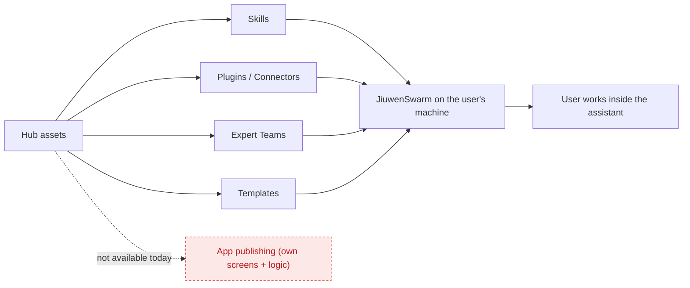
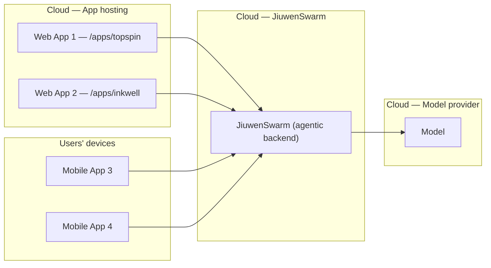

<!-- Speaker notes: exactly two slides.
     Slide 1 = the plugin route. Slide 2 = run it ourselves + monetization.
     Render with Marp (mermaid blocks need the marp mermaid plugin, or paste the diagrams as images). -->

# 1 · Publishing as a plugin

### The suggested route — and where it stops

- The Hub publishes **Skills · Plugins/Connectors · Expert Teams · Templates** — all extend the assistant **inside JiuwenSwarm**.
- None is a complete app. **InkWell / TopSpin** have their own screens + logic, so a plugin can share their *knowledge or tools* — **not the app itself**.
- **What would make it possible** — the **Jiuwen team** would need to add: **(1)** a Hub type for complete applications, **(2)** install support in JiuwenSwarm that sets it up and shows **the app's own interface**.
- **Bottom line:** not available today. When it is, it becomes the natural channel *inside* the ecosystem.

---

# 2 · Running it ourselves — and how we earn

**Deployment — an always-on agent** *(like Muse / Dots / Grok)*

- Host JiuwenSwarm in the cloud; our apps are the **front end**, JiuwenSwarm is the **agentic backend**.
- One backend, many apps. **Web = open a link · Mobile = install from a store** — otherwise identical.

**Monetization**

- **Free tier · Monthly paid tiers · Per usage · One-time license · Business / white-label**
- Model cost — one choice up front: **we include it**, or **users bring their own key**.
