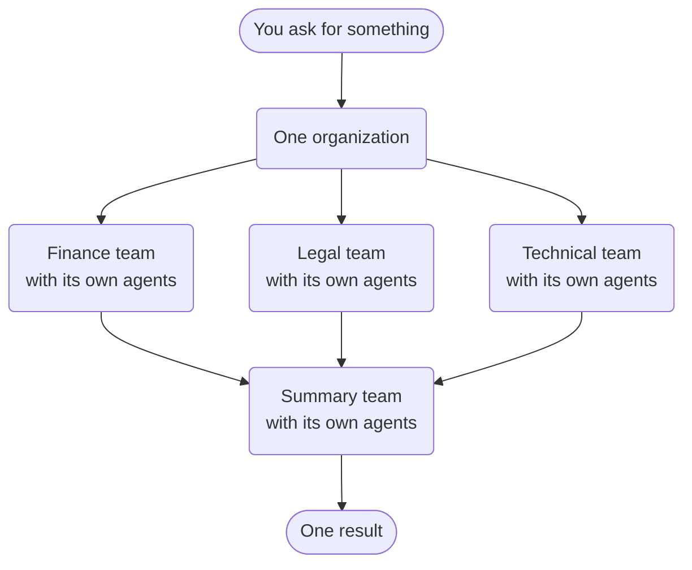
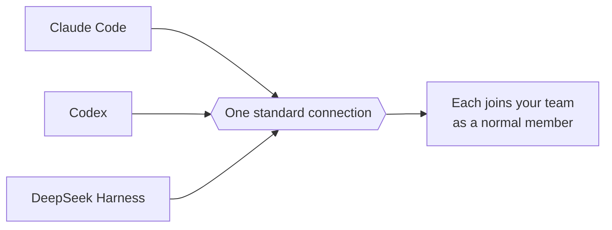
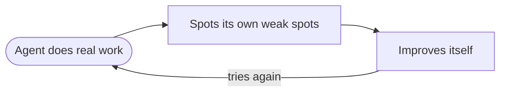

# What's New in JiuwenSwarm — Since August 2026

A short, plain-English guide for people who already know the product and just want to
catch up on what changed in the last ~2.5 months.

Everything here is tagged with one of two labels:

- **[NEW]** — a genuinely new capability that did not exist before.
- **[UPGRADE]** — an existing capability that was re-worked so deeply that it now feels
  new. These are "much better", not "new".

This document is arranged for a talk: **three things are worth the full story**, and the
rest are grouped by theme so each can stay a short mention.

---

# The three big things

## 1. Team Organization (Team of teams) — [NEW]

JiuwenSwarm went from single agent teams to an **organization of teams**. The key shift is
that you no longer assemble the work — you **brief an organization**: you state a goal, the
organization plans it and puts tasks on a shared board, and the expert teams best suited to
each task **claim** it. When the results come back, a lazily created **summary team**
consolidates them into one result. No graph to wire, no steps to sequence — the
organization routes the work itself, and it has its own web UI.



Two things make it much bigger than "run a few teams and merge the output":

- **Persistence — an organization, not a run.** The organization keeps its own memory: a
  shared task pool, task lineage, review state, an inbox and a workspace. Teams come and
  go; the organization stays, and you can re-brief it on a new goal tomorrow.
- **Composability — teams are products.** An expert team is a reusable, installable
  package, so composing an organization means choosing capabilities. Add a new expert team
  and it starts taking work immediately — which makes this an ecosystem of plug-in teams.

It also ships with governance built in: an independent review before a result is accepted,
and a distinct summary role.

How the three levels relate:

| Level | Think of it as… | What it gives you | Where it stops → and who picks it up |
|---|---|---|---|
| **Agent** | One person | Gets a task done. | Work that needs parallel hands, a second opinion, or lasting shared context. **→ Team** |
| **Team** | A department | A lead plus a crew split one goal, work in parallel, and stay in sync. | Goals that span several specialties, each deserving its own crew. **→ Organization** |
| **Organization** | A company | Many crews share one board: the right crew takes the right work, and one result comes back. | — |

## 2. Third-party agents as first-class team members — [NEW]

JiuwenSwarm can now host *other people's* agents as team members. Before, each one had to
be wired in by hand (Claude Code and Codex worked that way); the new "harness provider"
protocol lets any external agent — including the DeepSeek Harness — plug in through one
standard interface and act like a normal teammate. Sign-in and switching a member's model
or reasoning effort are handled for you.



## 3. RSI — Recursive Self-Improvement — [NEW]

RSI is a new module that lets the system **improve itself**. It watches how the agent
actually behaved on real tasks, finds weak spots, and proposes changes to the agent's own
harness and prompts. A separate evaluator agent then scores those changes, and only the
ones that genuinely help are kept. There is also an online reinforcement-learning loop
that keeps tuning the agent over time — so the system gets better from real usage instead
of only from human editing.

*How this differs from our existing "self-evolving" work: self-evolving tunes the agent's
own prompts, tools and skills from experience; RSI goes one level up and improves the
harness itself, and can recursively improve how it does that.*



---

# The rest, by theme

## Agents working with agents

### 4. Agent-teams rework — [UPGRADE]

The team engine was reworked in several deep ways. Team members can now be task-scoped, so
they live only as long as the task needs them and are shut down afterwards. Teams support
fork and checkpoint modes for branching work, and member models can be routed through
model groups. This is a substantial upgrade of the existing team system rather than a new
subsystem.

### 5. Scheduled dispatch + verification layer — [NEW]

Teams can now be put on a schedule. Instead of always running everything live, work can
be dispatched on a timer to read-only reviewers, and a verification step checks the
result before it is accepted. This targets autonomous runs where you want a safety check
without a human approving every single step.

## Getting smarter

### 6. Symphony — [UPGRADE]

Symphony's graph-based skill orchestration became substantially more capable. It now
learns from real executions and distills them into reusable, installable "skill packs",
groups equivalent skills together, and speaks the standard JGF graph format, so skills
can be composed and reused far more effectively.

### 7. Context evolution and proactive context — [UPGRADE]

The context and evolution rails were extended so the agent can gather useful context
proactively (for example, from GitCode) instead of only when asked. Context is now managed
in collections that you can browse and query, and the system gives clearer explanations of
how and why context was compacted. This builds on the context-evolution machinery that
already existed.

### 8. LLM layer — thinking modes and model groups — [UPGRADE]

The model layer now supports explicit thinking and reasoning-intensity modes, model-group
configuration with routing policies, the OpenAI Responses API, and streaming of
function-call arguments as they are generated. This is an upgrade to the existing LLM
plumbing, but it changes how much control you have over model behavior and cost.

## Control, safety and operations

### 9. Smart approval + permission modes — [NEW]

The permission system became much smarter. There are now three clear modes — Full
Access, Auto, and Strict — and permissions are tracked in layers (global, per-user, and
per-session). On top of that, a "smart approval" feature lets the model judge whether an
action is safe and approve it automatically, so users see far fewer prompts while still
staying protected.

### 10. A4P — intent authorization — [NEW]

A4P is an intent-authorization protocol. It lets a user pre-approve what an agent is
allowed to do for a session or a scheduled job, so the agent does not stop and ask for
permission on every action. Approvals are tied to a clearly stated intent, which makes
automation smoother while still keeping a record of exactly what was authorized.

### 11. Heartbeat (re-worked) — [UPGRADE]

Heartbeat existed before as a lightweight keep-alive. It was re-worked into a Rail-based
heartbeat managed by the AgentServer, and it now has a web panel so you can see and manage
heartbeat tasks directly instead of treating them as an internal mechanism.

## Build, observe and ecosystem

### 12. Headless agent runtime (Process CLI + SDKs) — [NEW]

Previously the agent mostly ran inside the web app. Now it can run headless too: a new
"Process CLI" executes a single agent one-shot over standard input/output, and Python and
TypeScript SDKs let any program drive an agent directly. The runtime itself also moved
into a resident worker process, which makes startup faster and keeps the "listen for
requests" step separate from the heavier "load the runtime" step.

### 13. Trajectory viewer — [NEW]

There is a brand-new way to look at what an agent did: a trajectory viewer. Every run is
saved with one consistent structure and stored by content, so you can replay it, page
through it turn by turn, and export it as an archive. It also surfaces timing such as
time-to-first-token, how context was compacted, and how a tool result looked to the model
versus what it actually returned.

### 14. Trajectory v2 — one consistent span-level schema — [UPGRADE]

Trajectory tracing already existed, but it was rebuilt around a single span-level schema
used across the whole system. Now every step of a run — model calls, tool calls, context
compaction — is recorded in exactly the same shape, so the viewer, the analysis tools, and
the backend all agree. It is technically an upgrade, but the data model and the new
viewer together amount to a next generation of the feature.

### 15. Marketplace / SkillHub — [NEW]

The marketplace grew into a hub for many kinds of assets, not just skills. There is now a
single search across skills, experts, plugins, and more, plus a web marketplace for
installing plugins and MCP servers. This makes it much easier to find and add new
capabilities to the product.

---

# Appendix — The slide

A single slide carrying the most important message (feature #1, Team Organization).

```
┌───────────────────────────────────────────────────────────────────────┐
│                                                                       │
│   From agents, to teams, to organizations                             │
│   Many expert teams, one goal, one result.                            │
│                                                                       │
│       •                  ●●●                 ▢▢▢                       │
│     Agent               Team             Organization                 │
│   one person         a department          a company                  │
│                                                                       │
│   Gets a task        Gets its part       Gets the whole job          │
│   done               done                done                         │
│                                                                       │
│                                                                       │
│   You don't manage agents.  You don't manage teams.                   │
│   You brief an organization.                                          │
│                                                                       │
│   Every angle covered — done well, not just done.                     │
│                                                                       │
└───────────────────────────────────────────────────────────────────────┘
```

Copy, ready to lift:

- **Title:** From agents, to teams, to organizations
- **Subtitle:** Many expert teams, one goal, one result.
- **Agent** (one person): *Gets a task done.*
- **Team** (a department): *Gets its part done.*
- **Organization** (a company): *Gets the whole job done.*
- **Footer:** *You don't manage agents. You don't manage teams. You brief an organization.*
- **Punch:** *Every angle covered — done well, not just done.*
